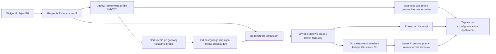

# Uzgodnienie wspólnych kosztów obu paneli — 21 października 2026

Punkt wyjścia: `35188ab` na `feature/role-based-timeline-costs`.
Bazowa walidacja: 236 testów zakończonych powodzeniem przed zmianami.
Poniższy raport zastępuje wcześniejsze wnioski o niezależnych stawkach Panelu 2.
Dalsza część pliku zachowuje historyczny audyt poprzedniego refaktoru.

Wspólny narzut jest pobierany wyłącznie z `koszt_staly_na_godzine` (36 zł/h).
Panel 1: `(roczne godziny bezpośrednie + roczne godziny dzienne) × stawka`.
Panel 2: `(wykonane godziny spraw + wykonane godziny dzienne) × stawka`.
To alokacja kosztów od pracy; nie jest stałym kalendarzowym budżetem kosztowym.
Usunięto kontrolki i domyślne parametry niezależnych opłat za sprawomiesiąc.
Stare niezerowe parametry są odrzucane jawnie, również w dołączonym słowniku
parametrów i starej konfiguracji TOML. Zerowe słowniki pozostają bezkosztową
warstwą zgodności dla istniejących wywołań API.

Sekretariat: `minuty / 60 × stawka × waga sprawy`, raz przy inicjacji
przyjęcia EH. `SEKRETARIAT_OBSLUZONY` zapisuje tożsamość, wagę, miesiąc i koszt.
Nie nalicza się go przy samym napływie, ponownej pracy, II instancji, zamknięciu
ani płatności. Zerominutowe przyjęcie z dostępną rolą inicjuje obsługę; bez
wymaganej roli nie występuje zdarzenie. Sekretariat nie zajmuje minut prawników,
nie dodaje pensji, nie zmienia ścieżek ani zegarów formalnych.

Czynności dzienne nadal należą do jednej osoby EH, raz dla zespołu. 90 min
przez 167/8 dni to 31,3125 h/mies. i 375,75 h/rok. Wynagrodzenie tych godzin
jest już w finansowanym przydziale. Wykonane godziny mają narzut 1127,25 zł/mies.
przy 36 zł/h; niewykonana część jest raportowana osobno i nie ma narzutu.
Panel 1 alokuje roczną kwotę dzienną na roczny napływ.

## Referencja 600 spraw i dokładnie dopasowane finansowane godziny

Porównanie dotyczy wyłącznie miesięcy 109–120 kontraktu i rocznej kohorty.
Domyślne ścieżki, WPS, P1/P2/P3, czasy i kalendarz pozostały zachowane.
Każda osoba zarabia 59,88 zł/h. Przydziały: EH1/EH2 po 100%,
EH3 `((4414.875/12 + 375.75/12 - 334)/167)*100`,
UGODY `(341.25/12/167)*100`, bez zaokrągleń procentów.

W obu panelach: przychód 451963,254 zł; płace 307296,675 zł;
EH bezpośrednio 4414,875 h; UGODY 341,250 h; dzienne 375,750 h.
Łącznie 5131,875 h/rok. Ukończenia: 600, backlog wykonalnej pracy 0 h,
dojrzałość `True`. Wszystkie porównywane kwoty różnią się o mniej niż 0,01 zł.

| Narzut zł/h | Koszty ogólne zł/rok | Sekretariat zł/rok | Koszt zł/rok | Wynik zł/rok |
| ---: | ---: | ---: | ---: | ---: |
| 0 | 0,000 | 0 | 307296,675 | 144666,579 |
| 10 | 51318,750 | 0 | 358615,425 | 93347,829 |
| 36 | 184747,500 | 0 | 492044,175 | −40080,921 |
| 60 | 307912,500 | 0 | 615209,175 | −163245,921 |
| 36 + sekretariat 30 min × 30 zł/h | 184747,500 | 9000 | 501044,175 | −49080,921 |

Średni narzut na sprawę: 307,9125 zł. Jednorazowy sekretariat: 15 zł/sprawę.
Te wskaźniki są tylko pochodną ekonomiczną; nie zastępują w kontrakcie
rzeczywistego naliczania od wykonanych godzin i zdarzeń.
Wyniki: [wspolne_koszty.json](audit_results/wspolne_koszty.json).

## Zasadne różnice, diagnostyka i korekta numeryczna

Panel 2 płaci niewykorzystany przydział. Panel 1 korzysta z arytmetycznej
średniej stawek roli; różny rozkład wynagrodzeń względem przydziałów może
powodować odmienną płacę efektywną. Diagnostyka `porownaj_panele` pokazuje
oba efekty osobno oraz zmianę pracy w porównywanym okresie. Niedobór ról,
backlog, oczekiwanie formalne, przyszła II instancja i płatności po okresie
mogą uzasadniać różnice przychodu i wyniku. Wskaźniki nie korygują żadnego
panelu w celu wymuszenia równości. Całego 120-miesięcznego wyniku nie
porównuje się z jedną roczną kohortą.

Wykryto błąd numeryczny w istniejącej inicjacji etapów: po odjęciu pojemności
śladowa dodatnia reszta float mogła rozpocząć następną sprawę. Przy nowym
sekretariacie tworzyłoby to przedwczesny koszt. Dodatnia praca inicjuje etap
przy pojemności powyżej istniejącej tolerancji 1e-8 minuty. Zerominutowe
etapy zachowują dotychczasowe reguły dostępności roli. Dodano regresję
(1 h dostępności, dwie sprawy po 1 h przyjęcia); nie przebudowano silnika.

## Walidacja bieżącej implementacji

- Pełne `python -m unittest discover -v`: **249 testów, OK**, 67,225 s.
  Obejmuje 15 Streamlit AppTests, 13 nowych regresji wspólnego kosztu i
  zachowane regresje ścieżek, FIFO, pojemności, przychodów oraz minut.
- `reconcile_shared_costs.py`: pięć wariantów uzgodnienia, OK, tolerancja 0,01 zł.
- `diagnostic_costs.py --output-dir /tmp/eh-shared-audit`: 10 scenariuszy,
  punkty 12/24/60 miesięcy, pełne bilanse zdarzeń, kosztów i pracy oraz
  most do modelu historycznego, OK. Aktualny skrót:
  [wspolne_scenariusze.csv](audit_results/wspolne_scenariusze.csv).
- `audit_checks.py`: 40 losowych scenariuszy z dodatnim sekretariatem,
  oddzielny audyt miesięcznych kosztów oraz zachowania spraw i minut, OK.
- `reproduce_baseline.py`: 10 scenariuszy i 600 historycznych miesięcy
  zgodnych z niezmienionym punktem odniesienia `99a2f1e`, OK.
- Kompilacja wszystkich plików Python, importy modułów i `git diff --check`: OK.
  Repozytorium nie ma dodatkowo skonfigurowanego lintera ani kontroli typów.
- Pomiary 60/120/360 miesięcy: stabilny zespół 0,205/0,552/1,333 s;
  przeciążenie EH 0,302/0,889/7,078 s; brak pracowników 0,333/0,944/8,271 s.
  Pełne dane: [wydajnosc.json](audit_results/wydajnosc.json).

AppTesty sprawdzają zmianę narzutu, czasu i stawki sekretariatu w obu
widokach, zachowanie ustawień i brak dawnych kontrolek Panelu 2.
Testy finansowe kontrolują miesięczne rozbicie narzutu, sekretariat z wagami,
płace, koszty, wynik i kumulację, bez NaN/inf w liczbowych wynikach referencji.
Koszty nie zmieniają ścieżek, pracy, pojemności, inicjacji etapów ani przychodu.

Nieśledzony test wcześniejszej rozbieżności zachowano bez zmiany treści jako
`audit_results/history/test_koszty_ogolne.py.txt`; SHA256:
`337ca8d347150fc025ba90b030979d9ea10ebcfda8c8477007ee6554530906e3`.
Nie jest aktywnym testem, ponieważ celowo dotyczy wycofanej księgowości.

Ograniczenia pozostają jawne: model wartości oczekiwanych, stały przydział
w symulacji, brak osobnego grafiku sekretariatu i brak stałego miesięcznego
budżetu narzutów. Panel 2 prezentuje wynik przed podatkiem.
Skrypty audytu stanowią niezależne sprawdzenie arytmetyki i zdarzeń,
a nie drugi niezależny silnik harmonogramowania.

---

# Archiwum audytu poprzedniej implementacji

# Audyt logiki spraw, harmonogramu FIFO i kosztów faktycznej pracy

Data: 19 października 2026. Gałąź: `feature/role-based-timeline-costs`.
Punkt wyjścia: `99a2f1e`; czyste drzewo robocze. Nie wykonano merge do `main`.

**READY FOR INDEPENDENT AUDIT — gotowe do niezależnego audytu.**

Przed zmianami przeczytano aplikację, modele, analizy, konfigurację,
dokumentację i testy; uruchomiono pełne 216 testów. Wszystkie przeszły,
choć część utrwalała zastąpione reguły biznesowe. Zapisano wyniki starego
silnika przed edycją i później odtworzono je ponownie z historii Git.

Status gotowości oznacza gotowość do audytu przez inną osobę. Skrypty bilansowe
są niezależne od pomocników arytmetycznych silnika; nie są drugim niezależnym
symulatorem harmonogramu ani opinią zewnętrznego audytora.

## 1. Potwierdzone błędy i zachowane formuły

1. Panel 2 naliczał opłaty od stanu otwartego na początku miesiąca wraz z
   napływem, również za kolejkę, formalne czekanie i miesiąc zakończenia.
   Taki rachunek przeczy nowej regule kosztu wyłącznie za dodatnią pracę.
2. `staff.py` rezerwował czynności dzienne oddzielnie dla każdej osoby;
   skrzynkę przypisywał UGODY. Zamiast stałego pakietu projektu powstawał
   koszt czasu rosnący wraz z liczbą pracowników.
3. Panel 1 stosował mnożniki `480/420` oraz `480/450`. Czynności dzienne były
   proporcjonalne do bezpośrednich godzin spraw zamiast stałe dla roku projektu.
4. `_dodaj_kohorte` tworzył pakiety przyjęcia, ugód i procesu równocześnie.
   Proces mógł wyprzedzić nieudaną próbę, a ugody — wymagane przyjęcie EH.
5. Kwalifikacja „brak szans” była przypisana UGODY. Zmieniono jej właściciela
   na EH, zachowując całe 30 minut i sumę pracy portfela.
6. Zegary formalne biegły od wpływu; kolejka nie przesuwała początku zegara.
   II instancja miała nominalny termin niezależny od jej faktycznego rozpoczęcia.
7. Proporcjonalne wykonanie całych grup rozpraszało minuty. Postęp pakietów
   nie zachowywał tożsamości konkretnych pracowanych spraw między etapami,
   więc nie nadawał się do naliczania unikalnych sprawomiesięcy.
8. Zerowe pakiety pomijano. Całkowicie zerowa praca mogła ominąć obowiązkową
   rolę i uruchomić formalne zakończenie mimo braku pracownika.
9. Poprzednia dokumentacja błędnie uznawała wielomilionowy narzut od formalnie
   otwartych spraw za zgodny z obecną regułą. Ten wniosek został zastąpiony.

Zachowano drzewo sześciu prawdopodobieństw, wzory wynagrodzenia za wynik
z limitami części zmiennej i podziałem WPS, miks P1/P2/P3, udział II instancji,
jedną płatność za sprawę, opóźnienie zapłaty oraz podatek Panelu 1.
Nie stwierdzono potrzeby zmiany tych formuł. Nie zmieniono referencyjnych
wartości `defaults.toml`, nie dodano pracy i nie wymuszano dodatniego wyniku.

## 2. Wspólny model etapów i właściciele

`workflow.py` definiuje niezmienne etapy: nazwa, rola, minuty jednej sprawy
oraz opcjonalny zegar formalny. Oba panele korzystają z tej samej definicji
przy wyznaczaniu minut ról. Czas P jest przypisany do przygotowania EH.



„Kategoryczna odmowa” i „brak szans” nie wymagają UGODY. W „brak szans”
30 minut kwalifikacji trafia do przyjęcia EH. Automatyczne ramy nie dodają
analizy możliwości ugody. Poza ramami udana i nieudana próba zawierają analizę
UGODY. Nieudana próba zachowuje ofertę i projekt, bez podpisania ugody.

Przy referencji, przed czasem P i oczekiwaną II instancją:

| Ścieżka | Udział | EH (min) | UGODY (min) | Razem (min) |
| --- | --- | --- | --- | --- |
| kategoryczna_odmowa | 15% | 280 | 0 | 280 |
| automatyczne_ramy_ugoda | 15% | 30 | 55 | 85 |
| automatyczne_ramy_brak_ugody | 15% | 280 | 35 | 315 |
| brak_szans | 27,5% | 310 | 0 | 310 |
| zawarte_poza_ramami | 13,75% | 30 | 85 | 115 |
| brak_ugody_poza_ramami | 13,75% | 280 | 65 | 345 |


Udane ugody: **28,75%**. Praca UGODY: **57,5%**, ponieważ obejmuje też
nieudane próby. Brak UGODY nie blokuje 42,5% ścieżek wyłącznie EH.

Roczne minuty EH to `600 × (30 + 150,3 + 0,275×30 + 0,7125×250 + 0,35625×210)`
= **264 892,5**. Minuty UGODY to `600 × (0,2875×55 + 0,2875×35 + 0,275×30)`
= **20 475**. Suma **285 367,5 min** pozostała niezmieniona. W porównaniu ze
starym podziałem EH zyskało dokładnie 4 950 min, a UGODY straciło 4 950 min.

## 3. FIFO, tożsamość i rachunek faktycznie pracowanych spraw

Segment P/WPS/ścieżka/wynik jest dzielony na reprezentantów o wadze 1 oraz
pozostałą wagę ułamkową, bez zaokrąglania liczby oczekiwanych spraw. Każdy
reprezentant ma trwały identyfikator, plan etapów, bieżący etap, pozostałe
minuty, datę dostępności, inicjacje, końce pracy i termin formalny.

Waga pozostaje stała przy częściowej pracy. Pozostałe minuty przechodzą do
następnego miesiąca. Etap jest gotowy dopiero po ukończeniu całej pracy tego
reprezentanta, a nie po wykonaniu proporcjonalnej części wszystkich pakietów.

Osobne kopce FIFO EH i UGODY porządkują pracę według daty dostępności, wpływu
i identyfikatora. Remisy wpływu są rozwiązywane kanonicznie przez P, grupę
WPS, ścieżkę, wynik instancji i numer reprezentanta. Kolejność słowników
wejściowych nie wpływa na wynik. Starszy dostępny odcinek ma pierwszeństwo;
zablokowany etap nie zatrzymuje innej roli ani niezależnego procesu.

Przyjęcie i bezpośredni proces należą do jednego odcinka kolejki EH,
z zachowaniem osobnych etapów wykonania i startu zegara procesu. Dlatego
50 spraw po 8 h przy 360 h dostępności daje 45 ukończonych odcinków i
**dokładnie 5 spraw / 40 h** w kolejce. Następny miesiąc zaczyna się od
5 + 50 = **55**, a nie 60 spraw do pracy. Nie rozprasza się po 90% pracy
na wszystkie 50 spraw.

Zbiór identyfikatorów z **dodatnimi wykonanymi minutami** w danym miesiącu
jest jedyną podstawą opłat. Suma ich wag to licznik spraw pracowanych.
Przyjęcie EH i praca UGODY w tym samym miesiącu występują w tym zbiorze raz.
Sprawa pracowana w dwóch miesiącach i czekająca kolejnych sześć nalicza dwie
opłaty. Nie dzielimy godzin przez średni czas sprawy.

## 4. Dwa zegary i konwencja miesięcy

Miesiące są numerowane od 1. Zegar formalny etapu jest inicjowany w miesiącu
pierwszych dodatnich minut **tego etapu**. Przyjęcie nie uruchamia zegara
procesu ani ugody. Termin formalny to `inicjacja + skonfigurowany lag`.
Po ukończeniu pracy wynik trafia do menedżera terminów, z datą nie wcześniejszą
niż termin formalny i miesiąc końca pracy. Wyniki formalne są rozstrzygane
na koniec miesiąca.

Proces po nieudanej próbie jest dostępny od miesiąca po zakończeniu pracy
UGODY. Nie dodano osobnego kalendarzowego okresu odrzucenia ugody.
II instancja jest dostępna od miesiąca po wyroku I. Jej zegar startuje dopiero
przy inicjacji własnej pracy. To jawna konwencja granic miesiąca: wynik
formalny zamyka miesiąc, a dalsza praca otwiera następny.

Dla sprawy kierowanej do II instancji wyrok I nie jest formalnym zakończeniem
całej sprawy i nie generuje odrębnego przychodu. Zapłata jest planowana raz,
po końcowym rozstrzygnięciu, w miesiącu powiększonym o opóźnienie płatności.

Etap zerowy nadal wymaga obecnej roli z dodatnią miesięczną pojemnością po
rezerwacji dziennych. Może być inicjowany bez minut; nie tworzy sztucznej
pracy ani opłaty. Zegar zaczyna się w miesiącu tej inicjacji. Brak roli,
zerowy przydział lub całkowite zajęcie EH dziennymi blokują jego inicjację.
Każda inicjacja zwiększa indeks etapu albo czeka na formalny termin, więc
etapy zerowe nie powodują nieskończonych pętli.

## 5. Aktualizacja miesiąca i zachowanie wszystkich minut

Kolejność: napływ; uwolnienie przekazań; rezerwacja dziennych; praca FIFO;
rejestr dodatnich minut i startów zegarów; odrzucenia ugód i przekazania na
następny miesiąc; formalne wyniki; przekazanie II na następny miesiąc;
płatności; pensje i opłaty; uzgodnienie portfela oraz wyniku.

W każdym miesiącu i każdej roli sprawdzane jest:

```text
backlog początkowy + nowa praca odblokowana − wykonane minuty = backlog końcowy
wykonane minuty + backlog + praca przyszła/zablokowana = praca wszystkich kohort
wpływ skumulowany − zakończenia formalne skumulowane = suma wag spraw otwartych
```

Praca przyszła jest sumowana ze stanów rzeczywistych spraw, nie obliczana
jako reszta równania. Kończenie spraw usuwa je z aktywnego portfela. Gotowa
praca nie wraca do kolejki, chyba że po wyniku uwolniono jawny kolejny etap.
Kontrola zdarzeń bada jednokrotną inicjację, koniec każdego etapu i brak
jakiejkolwiek pracy po ostatecznym zamknięciu sprawy.

## 6. Dzienne raz dla projektu i pensje

```text
dni projektu/mies. = 167 / 8 = 20,875
90 min/dzień → 31,3125 h/mies. → 375,75 h/rok
3 EH: 3 × 167 − 31,3125 = 469,6875 h bezpośrednich/mies.
```

Wszystkie trzy czynności dzienne, również skrzynka ugód, należą do EH.
Wybierana jest jedna rzeczywista osoba EH o największym dodatnim przydziale;
przy remisie pierwsza w obsadzie. Wymóg 31,3125 h jest niezależny od liczby
osób. Wykonanie nie przekracza godzin tej osoby. Jeśli ma np. 20 h, wykonuje
20 h, 11,3125 h pozostaje jawnie nieobsłużone; nie przerzuca się reszty na
kolejnego pracownika. Brak EH daje zerowe wykonanie i pełen niedobór.

Pensja osoby pozostaje `167 × przydział/100 × indywidualna stawka`.
Nie dodaje się wynagrodzenia za minuty spraw ani osobnej pensji za dzienne.
Przy stawkach EH 10/15/20 średnia Panelu 1 wynosi 15 zł/h, a 90 min pracy
dziennej ma wartość wynagrodzenia 22,50 zł/dzień. W Panelu 2 pensje pozostają
indywidualne, również gdy osoba jest bezczynna.

## 7. Koszty dwóch paneli i niezależna wycena minut

Panel 2:

```text
koszt_m = pensja_EH + pensja_UGODY + pracowane_sprawy_m × O + pracowane_sprawy_m × S
wynik_m = płatności_m − koszt_m
wynik_skumulowany = suma wyników_m
```

Opłaty nie używają liczby otwartych spraw ani liczby spraw w kolejce.
Miesiąc zakończenia lub płatności bez pracy ma zerową opłatę od danej sprawy.
Stawki O/S nie wpływają na kolejność pracy, zakończenia ani przychód.
Regresja 0 → 43 zł dowodzi równości zmiany wyniku z
`−43 × suma unikalnych pracowanych sprawomiesięcy`.

Panel 1:

```text
bezpośrednie wynagrodzenie = EH_h × średnia_EH + UGODY_h × średnia_UGODY
bezpośredni narzut = bezpośrednie godziny obu ról × narzut_h
roczny koszt dzienny = 250,5 × minuty_dzienne/60 × (średnia_EH + narzut_h)
alokacja dzienna/sprawę = roczny koszt dzienny / roczny napływ
sekretariat/sprawę = minuty_sekretariatu/60 × stawka_sekretariatu
```

Pusty portfel ma zerową alokację dzienną. Nie ogranicza się godzin lifecycle
mocą FTE. Wrażliwość, progi, WPS, P i porównania ugód używają tej samej
wyceny. Test każdego wejścia czasowego dodaje niezależnie 1 minutę i sprawdza
analityczną zmianę kosztu przy odrębnych stawkach EH i UGODY.

Referencja Panelu 1: 4 756,125 h bezpośrednich oraz 375,75 h dziennych rocznie.
Bezpośrednie pensje 284 796,765 zł; dzienne pensje 22 499,91 zł; bezpośredni
narzut 171 220,50 zł; dzienny narzut 13 527 zł; sekretariat 0 zł.
Suma = **492 044,175 zł**, czyli **820,073625 zł/sprawę**.
Dzienna alokacja to 36 026,91 zł rocznie / 600 = **60,04485 zł/sprawę**.
Przychód 451 963,254 zł daje wynik **−40 080,921 zł**.
Żadna z tych kwot nie jest dodawana do kosztów miesięcznego kontraktu.

## 8. Dziesięć wymaganych scenariuszy

Wspólne: 600 spraw/rok, 59,88 zł/h każdej osoby, 100% przydziału, referencyjne
lagi 6/9/6 miesięcy, zapłata bez opóźnienia, sekretariat miesięczny 0 zł.
Odmienny skład albo zmiana czasu jest wyszczególniona poniżej. Scenariusz 9
używa jawnie 1 EH + 1 UGODY. „Bieżąca konfiguracja” w scenariuszu 10 oznacza
referencję repozytorium; nie ma dostępu do odmiennych historycznych ustawień
sesji użytkownika. Domyślne O/S w aplikacji nadal wynoszą zero.

| Nr | Ustawienia | Wynik 12 mies. (zł) | Wynik 24 mies. (zł) | Wynik 60 mies. (zł) |
| --- | --- | --- | --- | --- |
| 1 | 1 EH + 1 UGODY; O=0 | -174 683,28 | -254 983,74 | -482 664,22 |
| 2 | 1 EH + 1 UGODY; O=43 | -194 741,78 | -295 557,25 | -585 783,24 |
| 3 | 3 EH + 1 UGODY; O=43 | -383 806,92 | -499 190,87 | -710 521,60 |
| 4 | Jak 3, dzienne=0 | -383 806,92 | -499 190,87 | -710 521,60 |
| 5 | Jak 3, dzienne=90 min/dzień | -383 806,92 | -499 190,87 | -710 521,60 |
| 6 | Jak 3, bezpośrednie czasy ×0,5 | -383 806,92 | -499 190,87 | -710 521,60 |
| 7 | 3 EH + 0 UGODY; O=43 | -368 449,69 | -637 979,95 | -1 373 520,23 |
| 8 | 0 EH + 1 UGODY; O=43 | -119 999,52 | -239 999,04 | -599 997,60 |
| 9 | 1 EH + 1 UGODY; praca bezpośrednia=0; O=43 | -109 985,69 | 57 038,15 | 692 930,79 |
| 10 | Referencja 1 EH + 1 UGODY; O=43; stary/nowy | -194 741,78 | -295 557,25 | -585 783,24 |


Scenariusze 3 i 5 są celowo identyczne: referencja ma już 90 min/dzień.
W 4 i 6 nie zmieniają się zakończenia ani przychód: trzy EH mają zapas mocy.
W 6 godziny bezpośrednie spadają dokładnie o połowę, ale te same etapy nadal
mieszczą się w tych samych miesiącach, pensje pozostają pełne i liczba
pracowanych sprawomiesięcy się nie zmienia. Osobna regresja przeciążenia
160 h/mies. dowodzi wzrostu przepustowości z 20 do 40 spraw po skróceniu
8 h do 4 h. Nie tworzy się nowego popytu.

Pełny zestaw wymaganych danych dla **każdego z miesięcy 12, 24 i 60** jest
w [CSV](audit_results/rekonsyliacja.csv), a przebiegi wszystkich miesięcy
w [JSON](audit_results/rekonsyliacja.json). Pliki zachowują niezaokrąglone
wartości obliczeń. Poniżej wyświetlono skrót po 60 miesiącach; każdy wariant
przyjął 3 000 spraw. Liczby spraw są wartościami oczekiwanymi.

| Nr | Otwarte | Do pracy | Pracowane w mies. 60 | Pracowane sprawomiesiące | Ugoda łącznie | I łącznie | II łącznie |
| --- | --- | --- | --- | --- | --- | --- | --- |
| 1 | 2 203,554312 | 2 092,940344 | 39,439625 | 2 398,116750 | 416,875000 | 267,745313 | 111,825375 |
| 2 | 2 203,554312 | 2 092,940344 | 39,439625 | 2 398,116750 | 416,875000 | 267,745313 | 111,825375 |
| 3 | 545,937500 | 192,500000 | 82,187500 | 4 731,562500 | 776,250000 | 901,250000 | 776,562500 |
| 4 | 545,937500 | 192,500000 | 82,187500 | 4 731,562500 | 776,250000 | 901,250000 | 776,562500 |
| 5 | 545,937500 | 192,500000 | 82,187500 | 4 731,562500 | 776,250000 | 901,250000 | 776,562500 |
| 6 | 545,937500 | 192,500000 | 82,187500 | 4 731,562500 | 776,250000 | 901,250000 | 776,562500 |
| 7 | 1 990,625000 | 1 831,250000 | 60,625000 | 3 531,250000 | 0,000000 | 541,875000 | 467,500000 |
| 8 | 3 000,000000 | 3 000,000000 | 0,000000 | 0,000000 | 0,000000 | 0,000000 | 0,000000 |
| 9 | 545,937500 | 32,187500 | 0,000000 | 0,000000 | 776,250000 | 901,250000 | 776,562500 |
| 10 | 2 203,554312 | 2 092,940344 | 39,439625 | 2 398,116750 | 416,875000 | 267,745313 | 111,825375 |


„Do pracy” obejmuje przyszłe etapy. „Backlog” w następnej tabeli obejmuje
bieżące odcinki, a dalsza praca zablokowana jest pokazana osobno.

| Nr | EH wykonane h | UGODY wykonane h | Dzienne h | Backlog EH h | Backlog UGODY h | Przyszłe/zablokowane h |
| --- | --- | --- | --- | --- | --- | --- |
| 1 | 8 141,250000 | 917,642250 | 1 878,750000 | 9 429,159937 | 0,000000 | 5 292,572813 |
| 2 | 8 141,250000 | 917,642250 | 1 878,750000 | 9 429,159937 | 0,000000 | 5 292,572813 |
| 3 | 21 365,885417 | 1 706,250000 | 1 878,750000 | 0,000000 | 0,000000 | 708,489583 |
| 4 | 21 365,885417 | 1 706,250000 | 0,000000 | 0,000000 | 0,000000 | 708,489583 |
| 5 | 21 365,885417 | 1 706,250000 | 1 878,750000 | 0,000000 | 0,000000 | 708,489583 |
| 6 | 10 682,942708 | 853,125000 | 1 878,750000 | 0,000000 | 0,000000 | 354,244792 |
| 7 | 16 599,375000 | 0,000000 | 1 878,750000 | 0,000000 | 1 706,250000 | 5 475,000000 |
| 8 | 0,000000 | 0,000000 | 0,000000 | 14 740,000000 | 0,000000 | 9 040,625000 |
| 9 | 0,000000 | 0,000000 | 1 878,750000 | 0,000000 | 0,000000 | 0,000000 |
| 10 | 8 141,250000 | 917,642250 | 1 878,750000 | 9 429,159937 | 0,000000 | 5 292,572813 |


## 9. Uzgodnienie wszystkich kosztów po 60 miesiącach

Sekretariat każdego z tych wariantów wynosi 0 zł. Jest jednak objęty
niezależnymi regresjami ze stawką dodatnią oraz losowymi bilansami.

| Nr | Przychód zł | Pensje EH zł | Pensje UGODY zł | Opłaty O zł | Koszt razem zł | Wynik zł |
| --- | --- | --- | --- | --- | --- | --- |
| 1 | 717 330,98 | 599 997,60 | 599 997,60 | 0,00 | 1 199 995,20 | -482 664,22 |
| 2 | 717 330,98 | 599 997,60 | 599 997,60 | 103 119,02 | 1 303 114,22 | -585 783,24 |
| 3 | 1 892 925,99 | 1 799 992,80 | 599 997,60 | 203 457,19 | 2 603 447,59 | -710 521,60 |
| 4 | 1 892 925,99 | 1 799 992,80 | 599 997,60 | 203 457,19 | 2 603 447,59 | -710 521,60 |
| 5 | 1 892 925,99 | 1 799 992,80 | 599 997,60 | 203 457,19 | 2 603 447,59 | -710 521,60 |
| 6 | 1 892 925,99 | 1 799 992,80 | 599 997,60 | 203 457,19 | 2 603 447,59 | -710 521,60 |
| 7 | 578 316,32 | 1 799 992,80 | 0,00 | 151 843,75 | 1 951 836,55 | -1 373 520,23 |
| 8 | 0,00 | 0,00 | 599 997,60 | 0,00 | 599 997,60 | -599 997,60 |
| 9 | 1 892 925,99 | 599 997,60 | 599 997,60 | 0,00 | 1 199 995,20 | 692 930,79 |
| 10 | 717 330,98 | 599 997,60 | 599 997,60 | 103 119,02 | 1 303 114,22 | -585 783,24 |


Przykład scenariusza 2, z danymi bez zaokrąglenia prezentacji:

```text
pensje EH = 60 × 167 × 59,88 = 599 997,60 zł
pensje UGODY = 599 997,60 zł
pracowane sprawomiesiące = 2 398,11675
narzut = 2 398,11675 × 43 = 103 119,02025 zł
sekretariat = 0
koszt = 1 303 114,22025 zł
przychód = 717 330,98148125 zł
wynik = −585 783,23876875 zł
```

Różnica scenariusza 2 względem 1 wynosi dokładnie −103 119,02025 zł.
Rozkład pracy, zakończenia i płatności są identyczne w każdym miesiącu.
Pensje nie są wyliczane ze średniej ani dublowane przez wykonane godziny.

## 10. Stary i nowy model oraz źródło dużych strat

Odtworzony stary wynik dla 1 EH + 1 UGODY i 43 zł wynosi
**−2 972 228,4551153868 zł**. Stary koszt całkowity to około **3 833 644,90 zł**.
Wartość około −4 mln zł nie ma utrwalonej konfiguracji; nie dopasowywano
parametrów, aby sztucznie uzyskać dokładnie tę liczbę.

| Obsada/O=43 | Stary wynik 60 mies. zł | Nowy wynik 60 mies. zł | Zmiana zł |
| --- | --- | --- | --- |
| 1 EH + 1 UGODY; O=43 | -2 972 228,46 | -585 783,24 | 2 386 445,22 |
| 3 EH + 1 UGODY; O=43 | -1 803 737,43 | -710 521,60 | 1 093 215,83 |


Most wyniku ma jawną kolejność: najpierw nowy harmonogram przy starej regule
opłat od otwartych spraw; potem zmiana podstawy opłat na faktyczną pracę.
To pozwala dokładnie uzgodnić sumę bez przypisywania tego samego efektu kilku
przyczynom. Wariant pośredni jest wyłącznie narzędziem audytu, nie trybem UI.

| Składnik mostu | 1 EH + 1 UGODY zł | 3 EH + 1 UGODY zł |
| --- | --- | --- |
| Zmiana kosztu pensji | 0,00 | 0,00 |
| Zmiana przychodu przez harmonogram | -144 085,46 | -18 441,67 |
| Zmiana opłat otwartych przez harmonogram | -432 275,93 | -62 444,06 |
| Zmiana reguły z otwartych na pracowane | 2 962 806,61 | 1 174 101,56 |
| Różnica wyniku | 2 386 445,22 | 1 093 215,83 |


Zmiana pensji ma w moście znak przeciwny do kosztu; tutaj wynosi zero.
Łączny spadek narzutu w scenariuszu 2 wynosi **2 530 530,680923995 zł**,
a spadek przychodu **144 085,46457735787 zł**. W efekcie strata zmniejsza
się o **2 386 445,216346637 zł**. To zmiana zgodna z regułami; spadek przychodu
nie jest ukrywany. Kosztów oczekiwania nie należy przywracać po to, aby
odtworzyć poprzednią stratę.

Zmiany pracy, zależności i terminów nie są niezależnymi addytywnymi źródłami
przychodu: czynności dzienne zmieniają pojemność, routing zmienia popyt ról,
a FIFO i zegary wspólnie zmieniają zakończenia. Nie istnieje jednoznaczny
rozdział ich efektów pieniężnych bez wskazania kolejności sztucznych
wariantów pośrednich. Raport zachowuje dokładny most kosztów i przychodów
oraz osobno ilościowe dowody wszystkich mechanizmów:

| Wielkość | 1 EH + 1 UGODY | 3 EH + 1 UGODY |
| --- | --- | --- |
| Stara pojemność EH (h/mies.) | 146,125000 | 438,375000 |
| Nowa pojemność EH (h/mies.) | 135,687500 | 469,687500 |
| Stara pojemność ugód (h/mies.) | 156,562500 | 156,562500 |
| Nowa pojemność ugód (h/mies.) | 167,000000 | 167,000000 |
| Stare czynności dzienne (h) | 1 878,750000 | 4 383,750000 |
| Nowe czynności dzienne (h) | 1 878,750000 | 1 878,750000 |
| Stare zakończenia | 1 082,249544 | 2 486,250000 |
| Nowe zakończenia | 796,445687 | 2 454,062500 |
| Stare sprawy otwarte | 1 917,750456 | 513,750000 |
| Nowe sprawy otwarte | 2 203,554312 | 545,937500 |
| Stary backlog EH (h) | 10 822,548095 | 0,000000 |
| Nowy backlog EH (h) | 9 429,159937 | 0,000000 |
| Stary backlog ugód (h) | 0,000000 | 0,000000 |
| Nowy backlog ugód (h) | 0,000000 | 0,000000 |


Stary backlog nie obejmował tak samo warunkowanych etapów jak nowy.
Porównanie jego surowej wielkości należy czytać wraz z pracą przyszłą,
wykonaniem i zakończeniami; samo przeniesienie minut między kolejką a blokadą
nie oznacza poprawy obsługi.

Przy jednej osobie każdej roli łączne dzienne godziny przypadkowo są równe
w obu modelach, ale rozkład zmienia się z EH/UGODY 20,875/10,4375 na
31,3125/0 h. EH ma więc mniejszą pojemność niż wcześniej, a po przeniesieniu
kwalifikacji również większy popyt. Przy 3 EH znika mnożenie pracy dziennej:
73,0625 h/mies. starego pakietu zastępuje 31,3125 h/mies. raz dla projektu.
Nie ma osobnej pieniężnej dopłaty za dzienne; wpływają przez pojemność.

Zmiana właściciela kwalifikacji to dokładnie ±4 950 min/rok opisane wyżej.
Poprawiony handoff wymusza późniejszy proces nieudanych prób. Kolejki
przesuwają początek zegarów, a II instancja dostaje własny zegar.
Pierwsze obserwowane miesiące zakończeń po 60 miesiącach:

| Rodzaj | Stary: 1 EH + 1 UGODY; O=43 | Nowy |
| --- | --- | --- |
| Ugody zakończone | 7 | 7 |
| Zakończenia po I instancji | 10 | 10 |
| Zakończenia po II instancji | 19 | 24 |
| Przychód razem | 7 | 7 |


| Rodzaj | Stary: 3 EH + 1 UGODY; O=43 | Nowy |
| --- | --- | --- |
| Ugody zakończone | 7 | 7 |
| Zakończenia po I instancji | 10 | 10 |
| Zakończenia po II instancji | 16 | 17 |
| Przychód razem | 7 | 7 |


Pierwszy miesiąc płatności nie opisuje całego rozkładu: komplet zmian
zakończeń i przychodów widać w obu miesięcznych plikach JSON. Zidentyfikowane
błędy techniczne — pomijanie roli w zerowych pakietach, przedwczesna
wymagalność etapów i używanie proporcji pracy jako zakończonych spraw —
naprawiono w silniku. Nie znaleziono dodatkowego dublowania indywidualnych
pensji; nie doliczono fikcyjnych oszczędności wynagrodzeń.

## 11. Sprawy otwarte, przyszła praca i rzeczywista stabilność

W dojrzałym scenariuszu 3 miesięcznie pracuje się nad **82,1875** sprawy:
50 bieżących przyjęć, 14,375 procesów po odrzuconej ugodzie oraz 17,8125
spraw w II instancji. Praca EH i UGODY w tym samym przyjęciu pozostaje jedną
opłatą. Otwartych jest **545,9375** spraw: 513,75 czeka na formalny wynik,
a 32,1875 na granicę miesiąca przekazania procesu lub II instancji.

„Do pracy” wynosi 192,5, bo obejmuje także przyszłą II instancję czekającą
na wyrok I. Ten licznik może przecinać się z oczekiwaniem formalnym.
Bieżący backlog obu ról wynosi zero; 708,489583333333 h przyszłej pracy jest
legalnie zablokowane wcześniejszym etapem i nie oznacza przeciążenia.

Po wyzerowaniu wszystkich bezpośrednich minut w scenariuszu 9 otwartych
pozostaje 545,9375 sprawy, formalnie oczekujących 513,75, a na inicjację
kolejnego etapu po granicy miesiąca czeka 32,1875. Bezpośrednia praca,
backlog godzinowy i opłaty za pracowane sprawy są **zerowe**. Różnica wobec
starych 513,75 otwartych wynika z jawnych granic przekazań, nie z dodatkowych
minut lub kosztów. Nadal płaci się pensje i wykonuje stałe czynności dzienne.

Scenariusz 2 jest operacyjnie przeciążony EH i nie otrzymuje etykiety stanu
stabilnego ani dojrzałego wyniku na podstawie płaskiej serii finansowej.
Scenariusz 3 jest stabilny operacyjnie, ale **nierentowny**: dojrzały przychód
37 663,6045 zł/mies., pensje 39 999,84 zł/mies., narzut 3 534,0625 zł/mies.,
czyli wynik **−5 870,298 zł/mies.** Bez narzutu byłoby **−2 336,2355 zł/mies.**
Deficyt rozruchowy, brak pojemności i ujemny wynik ekonomiczny są odrębne.

## 12. Testy, audyt niezależnej arytmetyki i interfejs

Końcowy pełny zestaw: **236 testów, OK** (`unittest discover -q`, 28,230 s).
Zapis walidacji: [walidacja.json](audit_results/walidacja.json).
Zawiera 38 regresji nowej logiki w `test_workflow.py`. Zachowano poprawne
regresje przychodu, WPS, prawdopodobieństw, podatku, wspólnej obsady,
sekretariatu, progów i prezentacji. Testy usuniętych prywatnych agregatów
zastąpiono regresjami konkretnych zdarzeń i tożsamości spraw; testy starej
reguły aktywności oraz mnożników przepisano według nowych równań.
Nie zmieniano oczekiwań w celu zaakceptowania błędnej logiki.

| Wymagania | Dowody |
| --- | --- |
| A–G, AF | 50/45/5 i 55 w kolejnym miesiącu; dwie opłaty za dwa miesiące; jedna opłata za EH+UGODY; niezmienne zdarzenia i −43 × sprawomiesiące |
| H–K | Brak UGODY blokuje 57,5%, 42,5% EH działa; proces dopiero po przekazaniu; ugody nigdy nie wchodzą w proces |
| L–O | Kolejka i przyjęcie nie startują zegara procesu; inicjacja, koniec pracy, termin, wyrok I i start II sprawdzane na zdarzeniach |
| P–R, AJ | Zerowe minuty, brak ról, zerowe przydziały i cały EH zajęty dziennymi; brak fikcyjnej pracy, płatności i opłat |
| S, X–Z | 160 h: 20 → 40 spraw po skróceniu czasu; reakcja wąskiego gardła; pół czasu w mieszanym przeciążonym portfelu; zapas mocy bez sztucznego przychodu |
| T–W, AA–AE | 469,6875 h EH; średnia 15 i 22,50 zł/dzień; jedna osoba do dziennych; indywidualne pensje i niezależne koszty paneli |
| AG–AI | Zachowanie minut i spraw, brak ponownej inicjacji/końca etapu, przesunięcie płatności bez pracy, niezmienność po odwróceniu słowników |
| AK | 60/120/360 miesięcy, przeciążenie, stabilna obsada i brak pracowników; skończone wartości w tabelach |


`diagnostic_costs.py` niezależnie rekonstruuje pensje z listy osób, dzienne
z kalendarza i dostępności jednej osoby, całe wymagane minuty z sześciu
prawdopodobieństw, opłaty ze zbioru identyfikatorów dodatniej pracy w dzienniku,
a stan otwarty z napływu i zakończeń. Nie wywołuje pomocników kosztów,
pojemności ani harmonogramu. Każdy miesiąc 10 wariantów uzgodniony.
`audit_checks.py` uzgadnia dodatkowo 40 deterministycznie losowanych
konfiguracji, również z zerowymi minutami, obsadą i stawkami, niepełnymi
przydziałami i 480 minutami dziennymi. Brak NaN, nieskończoności i niepoprawnych
dzieleń w badanych przebiegach. Wynagrodzenia, sekretariat i narzut nie dublują się.

AppTests sprawdzają oba panele, zmiany osób i ich stawek, zachowanie ustawień
przy usuwaniu/dodawaniu pracowników, zmianę widoku oraz odrębność opłat.
Nie ma dawnego globalnego wejścia płacy. Zmieniono polskie etykiety czasu,
liczników spraw i miesięcznych kosztów; jasno opisano brak kosztów oczekiwania.

Uruchomiono rzeczywisty Streamlit na lokalnym adresie i Chrome headless
z osobnym tymczasowym profilem. Sprawdzono ekonomię, kontrakt, rozliczenie,
brak wyjątków i powrót do ekonomii. Obejrzano zrzuty:
[Panel 1](audit_results/ui_ekonomika.png),
[Panel 2](audit_results/ui_kontrakt.png),
[rozliczenie](audit_results/ui_rozliczenie.png).

## 13. Wydajność

Pomiar lokalny po optymalizacji planów minut i menedżera wyników formalnych,
bez pełnego dziennika zdarzeń. Bilans rzeczywistego portfela jest nadal
sprawdzany co miesiąc, a pamięć zakończonych spraw jest zwalniana.

| Obsada | 60 mies. s | 120 mies. s | 360 mies. s |
| --- | --- | --- | --- |
| Przeciążenie EH | 0,108 | 0,363 | 3,779 |
| Stabilny operacyjnie | 0,070 | 0,142 | 0,443 |
| Brak pracowników | 0,137 | 0,463 | 4,153 |


Pełne dane: [wydajnosc.json](audit_results/wydajnosc.json). Przy przeciążeniu
narasta liczba rzeczywiście otwartych reprezentantów, dlatego najdłuższy
przebieg jest droższy niż stabilny. Dla referencyjnego napływu 360 miesięcy
pozostaje obsługiwane w około cztery sekundy również bez pracowników.

## 14. Pliki i odtworzenie

- `workflow.py`: wspólne etapy, role i bezpośrednie minuty sześciu ścieżek.
- `timeline.py`: stan sprawy, FIFO, przekazania, zegary, wyniki, zapłaty,
  unikalne pracowane sprawomiesiące, bilanse i ocena stabilności.
- `staff.py`: stałe dzienne raz dla projektu i przypisanie jednej osobie EH.
- `model.py`: zachowane przychody, poprawiony podział ról, roczna alokacja
  dziennych, bezpośrednie koszty i wspólne progi.
- `analysis.py`: wycena porównań bez dawnych mnożników godzin.
- `app.py`, `ui_case.py`, `ui_timeline.py`: polskie etykiety, transparentne
  koszty, liczniki spraw i interpretacja dziennych oraz oczekiwania.
- `test_model.py`, `test_analysis.py`, `test_timeline.py`, `test_app.py`,
  `test_reconciliation.py`: migracja zastąpionych reguł z zachowaniem poprawnych
  regresji; `test_workflow.py`: niezależne nowe scenariusze A–AK.
- `diagnostic_costs.py`, `audit_checks.py`, `reproduce_baseline.py`: audyty,
  wymagane warianty, dokładne odtworzenie starego kodu i pomiary wydajności.
- `README.md`, `AUDYT.md`, `audit_results/*`: aktualne reguły i dowody liczbowe.

`config.py`, `defaults.toml`, `main.py`, `requirements.txt` i poprawny
`test_ui_timeline.py` nie wymagały zmiany. Nazwy kluczy kosztów w TOML i API
zachowano dla zgodności; ich nowe znaczenie jest opisane w UI i README.
Nie przywrócono duplikatu płacy ani nie zmieniono 0 zł na przykład 43 zł.

```bash
.venv/bin/python -m unittest discover -v
.venv/bin/python reproduce_baseline.py
.venv/bin/python diagnostic_costs.py --output-dir audit_results
.venv/bin/python audit_checks.py
```

## 15. Pozostałe konwencje i ograniczenia

Nie pozostała znana blokada względem uzgodnionych reguł. Jawne konwencje
miesięcy i remisów FIFO opisano wyżej. Czas P jest przygotowaniem EH dla
wszystkich ścieżek; odrzucenie ugody następuje po pracy, bez nowego laga.
II instancja zaczyna się najwcześniej w miesiącu po wyroku I.

Wyniki są wartościami oczekiwanymi i obliczeniami zmiennoprzecinkowymi.
Nie zaokrągla się danych do obliczeń; tolerancje weryfikacyjne dotyczą
wyłącznie błędów reprezentacji liczb. Wyświetlanie zaokrągla kwoty do groszy,
liczniki w tabelach audytu do sześciu miejsc. Raport nie utożsamia
oczekiwanego portfela z wylosowanym zestawem fizycznych spraw.

Dane nie odtwarzają nieutrwalonego ustawienia około −4 mln zł. Odtworzono
konkretny, weryfikowalny wynik −2,97 mln zł oraz wszystkie 10 wariantów starego
silnika. Nie dodano urlopów, sezonowości, inflacji ani zmiany obsady w trakcie
jednego przebiegu. Są to granice modelu, a nie ukryte poprawki rentowności.
